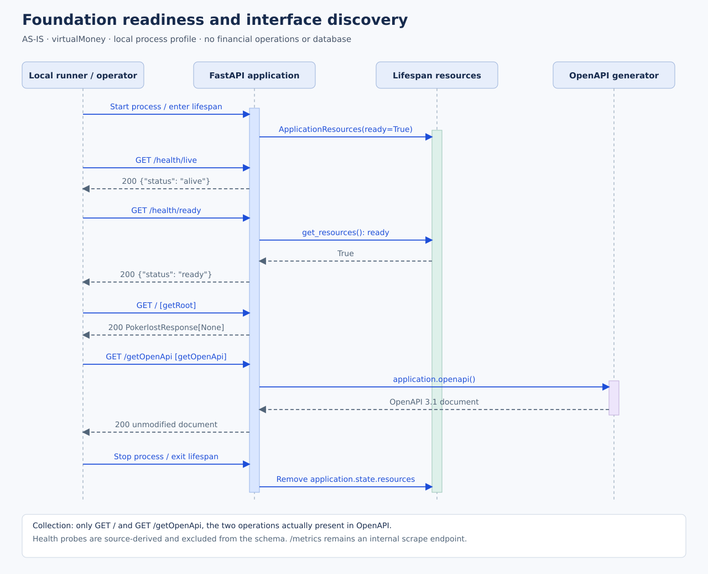

# Foundation readiness and interface discovery

This AS-IS use case belongs to virtualMoney. A local operator checks process readiness and discovers the public infrastructure interface. It does not execute a financial operation. The verified runtime snapshot is `27a19412870866da937465f14ab77ba8541223c2`; artifact refreshes must review runtime changes before updating this baseline.

## Scope and actor

The actor is a local operator or probe. The application factory composes HTTP behavior without import-time network access. Entering the ASGI lifespan creates process-owned `ApplicationResources(ready=True)`; leaving it removes those resources. The active profile has no database resource or business route. There is no entity relationship diagram or business role model to infer from this foundation. Planned capabilities remain in the service's `SERVICE.md`.

The two public infrastructure operations require no access token. This grants no authorization to future protected operations. Existing SDK admission, SSH authentication and immutable dependency-pin policies continue to apply when preparing the environment. The SDK's canonical contract remains owned by pypokerlost; this document describes only the service probe.

## Main flow

1. Start a prepared local service process and enter its lifespan.
2. `GET /health/live` returns HTTP 200 and `{"status":"alive"}` without checking dependencies.
3. `GET /health/ready` returns HTTP 200 and `{"status":"ready"}` while the enabled resource state is ready.
4. `GET /` (`getRoot`) returns HTTP 200 and the exact success envelope below.
5. `GET /getOpenApi` (`getOpenApi`) returns HTTP 200 and the application's unmodified OpenAPI document, without a Pokerlost response envelope.
6. Stop the process; the lifespan removes `application.state.resources`.

```json
{"ok":true,"result":null,"error":null,"error_message":null,"retry_after":null}
```



The editable SVG is the sequence source; the PNG is a visual-review preview. All collaborators in the sequence are local process components. Health behavior is source-derived: both health routes use `include_in_schema=False` and are deliberately absent from the OpenAPI snapshot and Postman collection. Internal metrics are outside this public scenario.

## Alternatives and limits

A missing route and disabled documentation routes return HTTP 404 with `VIRTUALMONEY_NOT_FOUND`. An unsupported method returns HTTP 405 with `VIRTUALMONEY_METHOD_NOT_ALLOWED`, preserving `Allow: GET`. Setting `ApplicationResources(ready=False)` produces readiness HTTP 503 with `VIRTUALMONEY_DEPENDENCY_UNAVAILABLE` while liveness remains available. That state is exercised by technical fault injection in an existing test; it is not evidence of a configured database, a database outage test or business availability.

## Requirement to existing test trace

These requirements describe existing behavior; they introduce no route or new domain requirement. Links fix the source revision used for the trace.

| Requirement | Implementation | Existing test |
| --- | --- | --- |
| F01: resources exist only during the lifespan and are instance-local | [create_lifespan](https://github.com/pokerlost/virtualMoney/blob/27a19412870866da937465f14ab77ba8541223c2/src/virtualmoney/app.py#L29) | [test_resources_require_a_running_lifespan](https://github.com/pokerlost/virtualMoney/blob/27a19412870866da937465f14ab77ba8541223c2/tests/foundation/test_http.py#L172); [test_application_resources_are_independent](https://github.com/pokerlost/virtualMoney/blob/27a19412870866da937465f14ab77ba8541223c2/tests/foundation/test_http.py#L155) |
| F02: process liveness and disabled routes have the stated responses | [health routes](https://github.com/pokerlost/virtualMoney/blob/27a19412870866da937465f14ab77ba8541223c2/src/virtualmoney/api/health.py#L15) | [test_infrastructure_and_disabled_routes](https://github.com/pokerlost/virtualMoney/blob/27a19412870866da937465f14ab77ba8541223c2/tests/foundation/test_http.py#L67) |
| F03: readiness reflects enabled resource state without replacing liveness | [ready](https://github.com/pokerlost/virtualMoney/blob/27a19412870866da937465f14ab77ba8541223c2/src/virtualmoney/api/health.py#L21) | [test_readiness_tracks_enabled_resources](https://github.com/pokerlost/virtualMoney/blob/27a19412870866da937465f14ab77ba8541223c2/tests/foundation/test_http.py#L272) |
| F04: root uses the five-field envelope; OpenAPI is returned unmodified | [root](https://github.com/pokerlost/virtualMoney/blob/27a19412870866da937465f14ab77ba8541223c2/src/virtualmoney/routers/root.py#L12); [OpenAPI](https://github.com/pokerlost/virtualMoney/blob/27a19412870866da937465f14ab77ba8541223c2/src/virtualmoney/routers/openapi.py#L11) | [test_public_root_and_unmodified_openapi](https://github.com/pokerlost/virtualMoney/blob/27a19412870866da937465f14ab77ba8541223c2/tests/foundation/test_pokerlost_http.py#L11) |
| F05: the pristine schema exposes only the two infrastructure GET operations | [create_app](https://github.com/pokerlost/virtualMoney/blob/27a19412870866da937465f14ab77ba8541223c2/src/virtualmoney/app.py#L45) | [test_pristine_openapi_keeps_infrastructure_exceptions](https://github.com/pokerlost/virtualMoney/blob/27a19412870866da937465f14ab77ba8541223c2/tests/foundation/test_operations.py#L18) |
| F06: HTTP 405 retains the protocol's allowed method | [factory and handlers](https://github.com/pokerlost/virtualMoney/blob/27a19412870866da937465f14ab77ba8541223c2/src/virtualmoney/app.py#L45) | [test_method_not_allowed_preserves_allow](https://github.com/pokerlost/virtualMoney/blob/27a19412870866da937465f14ab77ba8541223c2/tests/foundation/test_http.py#L81) |
| F07: imports do not acquire settings or network resources | [create_app](https://github.com/pokerlost/virtualMoney/blob/27a19412870866da937465f14ab77ba8541223c2/src/virtualmoney/app.py#L45) | [test_import_has_no_settings_or_network_side_effects](https://github.com/pokerlost/virtualMoney/blob/27a19412870866da937465f14ab77ba8541223c2/tests/foundation/test_http.py#L245) |

## Bounded collection

[The collection](foundation_probe.postman_collection.json) derives exactly `getRoot` and `getOpenApi` from [the observed OpenAPI 3.1 snapshot](foundation_openapi.json). It contains two GET requests, no body and no authorization material. Its `baseUrl` defaults to `http://127.0.0.1:8000`; explicitly choose a local process before running it. Do not expand this allowlist to financial or protected operations as part of regeneration.

The collection validates against the official [Postman v2.1 Draft-07 schema](https://schema.postman.com/collection/json/v2.1.0/draft-07/collection.json). Its test scripts assert the exact root envelope and documented operation IDs. Collection serialization, schema validity, route parity and equivalent in-process HTTP assertions were checked. Postman/Newman execution of the JavaScript scripts was not performed; a collection import is not a runner pass.

## Refresh and validation

Use a prepared, isolated service interpreter matching the reviewed source (`SERVICE_PYTHON`), not an unreviewed install. From this artifact directory, refresh only the OpenAPI snapshot:

```bash
"$SERVICE_PYTHON" -I -B - <<'PYTHON'
import json
from pathlib import Path
from fastapi.openapi.models import OpenAPI
from virtualmoney.observability import ObservabilitySettings
from virtualmoney.app import create_app
from virtualmoney.settings import ServiceSettings
app = create_app(ServiceSettings(_env_file=None, log_level="WARNING"),
                 telemetry=ObservabilitySettings(_env_file=None, metrics_enabled=False))
document = app.openapi()
OpenAPI.model_validate(document)
Path("foundation_openapi.json").write_text(json.dumps(document, indent=2) + "\n")
PYTHON
```

The FastAPI model check is structural. The snapshot also passed independent OpenAPI 3.1 validation with the pinned ephemeral validator below; it changes no product dependency or lock. This checks the specification, not business completeness. Review any changed paths or operation IDs before refreshing the bounded collection.

```bash
uv run --isolated --no-project --no-env-file --with openapi-spec-validator==0.7.2 \
  openapi-spec-validator --schema 3.1 foundation_openapi.json
```

Preserve the collection's explicit assertions and verify request parity:

```bash
python3 -B - <<'PYTHON'
import json
from pathlib import Path
spec = json.loads(Path("foundation_openapi.json").read_text())
collection = json.loads(Path("foundation_probe.postman_collection.json").read_text())
expected = {"getRoot": "/", "getOpenApi": "/getOpenApi"}
assert set(spec["paths"]) == set(expected.values())
assert len(collection["item"]) == len(expected)
for item in collection["item"]:
    path = expected[item["name"]]
    assert spec["paths"][path]["get"]["operationId"] == item["name"]
    assert item["request"]["method"] == "GET"
    assert item["request"]["url"] == "{{baseUrl}}" + path
    assert "body" not in item["request"]
PYTHON
```

For formal collection validation, obtain the official schema above into a temporary cache, verify SHA-256 `90a81dbfd6aae2b1605f5d987d08a2bdab51a68c2a027ecffc52b11656ef7d8b`, then use an existing `jsonschema` installation:

```bash
python3 -B - "$POSTMAN_SCHEMA" <<'PYTHON'
import hashlib
import json
import sys
from pathlib import Path
from jsonschema import Draft7Validator
raw = Path(sys.argv[1]).read_bytes()
assert hashlib.sha256(raw).hexdigest() == "90a81dbfd6aae2b1605f5d987d08a2bdab51a68c2a027ecffc52b11656ef7d8b"
schema = json.loads(raw)
Draft7Validator.check_schema(schema)
Draft7Validator(schema).validate(json.loads(Path("foundation_probe.postman_collection.json").read_text()))
PYTHON
```

The SVG needs no generator or product dependency. After editing it, render and visually check the result with an existing local SVG renderer. Set `SVG_PREVIEW` to a temporary PNG path outside the product checkout; the preview is QA evidence, not a tracked second diagram. The reviewed preview used installed PyGObject/librsvg:

```bash
python3 -B - "$SVG_PREVIEW" <<'PYTHON'
import sys
import gi
gi.require_version("Rsvg", "2.0")
from gi.repository import Rsvg
image = Rsvg.Handle.new_from_file("foundation_probe_sequence.svg").get_pixbuf()
image.savev(sys.argv[1], "png", [], [])
PYTHON
```
